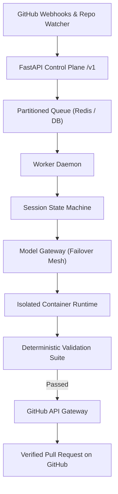

<div align="center">
  
  <h1>AutoMaintainer</h1>
  <p><strong>The bot that quietly fixes your stale repos while you sleep.</strong></p>

  <p>
    <a href="https://github.com/abhinav00anand/automaintainer"></a>
    <a href="https://automaintainer.onrender.com/status"></a>
    <a href="https://github.com/abhinav00anand/automaintainer/actions"></a>
    <a href="https://github.com/abhinav00anand/automaintainer/blob/main/LICENSE"></a>
  </p>

  <h3>
    <a href="#-what-it-fixes">What it fixes</a>
    <span> | </span>
    <a href="#-how-it-works">How it works</a>
    <span> | </span>
    <a href="#-safety-ground-rules">Safety Rules</a>
    <span> | </span>
    <a href="#-architecture">Architecture</a>
    <span> | </span>
    <a href="#-getting-started">Getting Started</a>
  </h3>
</div>

<br/>

> [!TIP]
> ### 🌐 Want AutoMaintainer to Maintain Your Repository?
> If you'd like AutoMaintainer to monitor your codebase, pin GitHub Action tags to immutable commit hashes, repair broken documentation links, and submit verified, minimal-diff pull requests:
> 1. **Install the GitHub App (Recommended)**: Install the official [AutoMaintainer GitHub App](https://github.com/apps/automaintainerbot) on your repositories or organization for automatic, real-time maintenance.
> 2. **Submit via Web Portal**: Visit the [AutoMaintainer Onboarding Portal](https://automaintainer.onrender.com/#onboard) to run a dry-run audit or enroll your public repository.
> 3. **Submit via GitHub PR**: Submit a pull request adding your repository identifier (e.g. `owner/repo`) directly to [`config/managed_repositories.yaml`](config/managed_repositories.yaml).
> 
> Platform Links:
> - ⚡ **[Install Official GitHub App](https://github.com/apps/automaintainerbot)**
> - 🌐 **[Live Web Platform](https://automaintainer.onrender.com/)**
> - 📊 **[System Health & Status](https://automaintainer.onrender.com/status)** — Live process uptime, gateway latency, and verified subsystem telemetry.

AutoMaintainer watches your public GitHub repos, finds outdated action hashes, broken docs links, and patch bumps, runs your actual test suite in a container, and opens one small, reviewable PR. No spam, no hallucinated rewrites.

---

## 🛠️ What It Fixes

- **GitHub Action Hash Pinning**: Replaces mutable `@v3` tags with immutable 40-character commit SHAs to protect against upstream supply-chain tampering, while preserving the human-friendly version in an inline comment.
- **Dead Documentation Links & Badges**: Scans markdown guides and READMEs for dead links and 404 targets. Verifies destinations with live HTTP HEAD checks before sending a single-line patch.
- **Conservative Dependency Bumps**: Proposes patch-level updates and repairs lockfiles without touching major API boundaries.
- **Interactive Pull Request Feedback**: Reply directly to any AutoMaintainer PR (e.g. *"please keep Node 18 for now"*), and the bot adjusts the branch and re-runs container verification.

---

## 🛡️ Safety Ground Rules

We designed AutoMaintainer under the assumption that noisy bots get uninstalled:

1. **Small, single-purpose diffs**: Every PR is small and focused on one specific chore. It will never do sweeping refactors, touch unrelated files, or reformat your code.
2. **Secrets and deploy files are off-limits**: Files like `.env`, credentials, production deployment manifests, and database migrations are permanently ignored.
3. **Strict anti-spam limits**: AutoMaintainer will never open more than 1 active pull request per repository. If you close a PR without merging, it backs off for 30 days.
4. **Isolated container test runs**: Runs your existing test commands in an isolated container before opening any PR. If tests fail, the change is discarded immediately.

---

## 🔄 Dual Execution Modes

| Feature | GitHub App Mode | Open-Source Disposable Fork Mode |
| :--- | :--- | :--- |
| **Actor** | `automaintainer[bot]` | `AutoMaintainerBot` / Support Actor |
| **Setup** | Install GitHub App on repository | Add repo to `config/managed_repositories.yaml` |
| **Authentication** | Scoped GitHub App JWT & Installation Tokens | Bot Organization Token |
| **Branch Target** | Direct in-repo branches (`automaintainer/sess_...`) | Disposable fork branches (`AutoMaintainerBot:...`) |
| **PR Type** | Direct Pull Request | Cross-Repository Fork Pull Request |
| **Trigger** | Webhooks (`push`, `workflow_run`) | Scheduled repository watcher & web portal |

---

## 🏛️ Architecture

The control plane coordinates scheduling and verification while isolating untrusted code in containers.



---

## ⚡ Getting Started

### Prerequisites
- Python 3.11+
- PostgreSQL & Redis (optional; SQLite and in-memory queue used for local development)
- Git 2.30+
- Optional: Docker for containerized test runs

### Local Installation

```bash
# Clone the repository
git clone https://github.com/abhinav00anand/automaintainer.git
cd automaintainer

# Create and activate virtual environment
python -m venv .venv
source .venv/bin/activate  # On Windows: .venv\Scripts\activate

# Install dependencies in editable mode
pip install -e ".[dev]"
```

### Environment Configuration

Copy `.env.example` to `.env` and fill in your credentials:

```bash
cp .env.example .env
```

Key environment variables:
- `GITHUB_APP_ID`: GitHub App numerical ID.
- `GITHUB_APP_PRIVATE_KEY`: GitHub App RSA private key in PEM format.
- `GITHUB_WEBHOOK_SECRET`: HMAC-SHA256 secret for webhook validation.
- `CEREBRAS_API_KEY` / `GROQ_API_KEY` / `GOOGLE_API_KEY`: API keys for inference.
- `DATABASE_URL`: PostgreSQL or SQLite connection URL.

### Running the Services

**1. FastAPI Control Plane & Webhook Receiver**
```bash
uvicorn automaintainer.app.main:app --host 0.0.0.0 --port 8000 --reload
```

**2. Worker Daemon**
```bash
python -m automaintainer.apps.worker.daemon
```

### Running Tests

Execute the test suite:

```bash
pytest tests/ -v
```

---

## 📄 License

AutoMaintainer is open-source software released under the [MIT License](LICENSE). Free for public open-source repositories.
